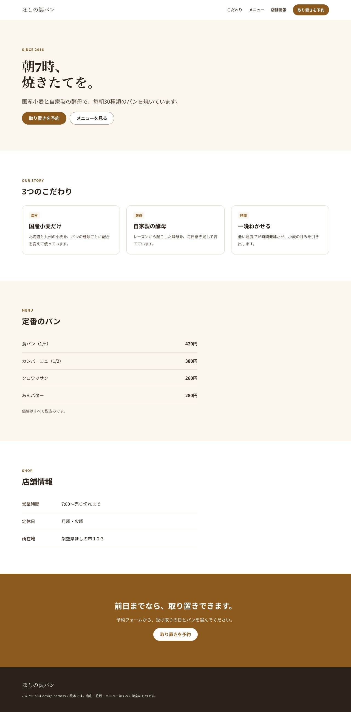
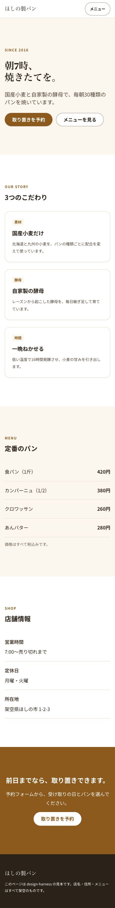
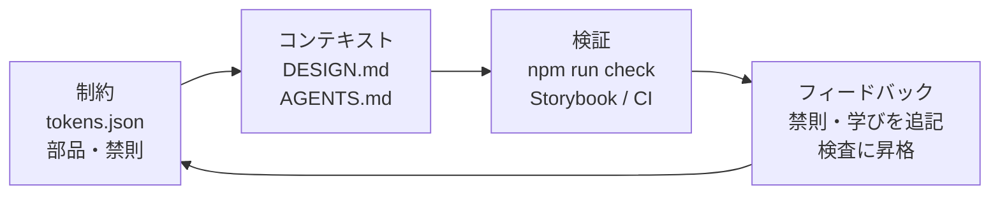

# design-harness

**A token-first design harness for teams where humans and AI agents build UI together.**
Design rules live in the repository (`tokens.json`, `DESIGN.md`, `AGENTS.md`) and are enforced by automated checks — hard-coded values, WCAG contrast, and SP/PC layout breakage — so AI-generated UI stays on-brand without a human catching every mistake.

---

AI エージェントに UI を作らせると、それらしいけれどブランドから外れたもの（色の直書き、読みにくい組み合わせ、SP での崩れ）が混ざります。**design-harness** は、見た目のルールをリポジトリのファイルと自動検査に置き、AI の実装とレビューを同じルールで回すためのテンプレートです。

実際の小規模事業者サイトのリニューアルで運用した仕組みを、クライアントの情報を除いて汎用化しました。見本は架空のパン屋「ほしの製パン」のトップページです。

| PC | SP |
|---|---|
|  |  |

## 4 つの層



| 層 | 置き場所 | 役割 |
|---|---|---|
| 制約 | `ui/src/tokens/tokens.json` | 色・余白・文字の値の正。CSS はここから生成した `var(--…)` だけを使う |
| コンテキスト | `DESIGN.md`、`AGENTS.md` | ブランドの原則、部品の使い方、禁則、作業とレビューの型。人と AI が最初に読む |
| 検証 | `scripts/check-*.mjs`、Storybook、GitHub Actions | 直値・未定義トークン・コントラスト・SP/PC の崩れを機械で落とす |
| フィードバック | `DESIGN.md` §5・§8 | 同じ指摘が 2 回出たら禁則に、機械で見られるものは検査に昇格させる |

## 検査の中身

`npm run check` が 2 つを順に実行し、1 件でも違反があれば失敗します（CI も同じ）。

- **check:tokens** — CSS の色・文字サイズ・太さ・フォント名の直値、未定義の `var(--…)`、コメントの閉じ忘れ、`tokens.css` の鮮度、`harness.config.json` に書いた色の組み合わせの WCAG コントラスト比
- **check:pages** — ビルドしたページを headless Chrome で SP 390 / PC 1280 で開き、横スクロール、はみ出し、h1 の数、alt の無い画像、ラベルの無いリンク、Web フォントの読み込み、文字切れを検査。スクリーンショットを `.check/` に保存

外部の検査ライブラリは使っていません（Chrome DevTools Protocol を Node 22 の WebSocket で直接扱っています）。

## 使い方

```bash
npm install
npm run dev          # 見本ページ（ui/index.html）
npm run storybook    # 部品とトークンの一覧（a11y パネルつき）
npm run check        # 検査（Google Chrome が必要。パスは CHROME 環境変数で変えられる）
```

## 自分のプロジェクトに合わせる

1. `ui/src/tokens/tokens.json` の色・文字・余白を自分のブランドに書き換え、`npm run tokens`
2. `DESIGN.md` の §1（原則）と §2（トークンの使い方）を書き換える
3. `harness.config.json` に検査するページ・画面幅・Web フォント・コントラストの組を書く
4. `ui/` のページと部品を作り替える。部品を作ったら Story を足す
5. AI エージェントには `AGENTS.md` を読ませる（Claude Code は `CLAUDE.md` 経由で自動で読む）

WordPress などのテーマに組み込むときは、生成した CSS をテーマへコピーするスクリプトを足し、テーマ側の CSS は直接編集しないルールにします。

## 構成

```
tokens.json ─ build-tokens ─▶ tokens.css ─▶ base / components / sections.css ─▶ ui/index.html・Storybook
                                   ▲                         │
                         check:tokens（直値・コントラスト）   check:pages（SP/PC の崩れ）
```

```
├── DESIGN.md / AGENTS.md / CLAUDE.md   ルール（人と AI が読む）
├── harness.config.json                 検査の対象と条件
├── scripts/                            build-tokens / check-tokens / check-pages
├── ui/src/tokens/                      tokens.json（正）→ tokens.css（生成物）
├── ui/src/styles/                      base / components / sections
├── ui/src/stories/                     Tokens / Parts / Sections
└── .github/workflows/check.yml         CI で npm run check
```

## License

MIT © Shohei Saito（[@shohezo](https://github.com/shohezo)）
